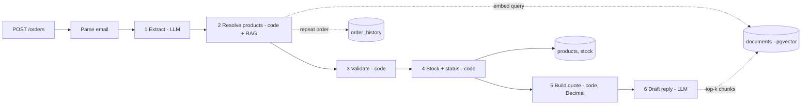

# Email-to-Order Processing System

Project 1 (order workflow) + Project 2 (RAG, product resolution, repeat orders, quotation)

A FastAPI service that reads a customer's raw email and returns a structured order, a status
(`Ready` / `Partial` / `Need info`), a list of issues, a price quote and a drafted reply, through one endpoint: `POST /orders`.

**Core rule: the LLM reads and writes text. Python code makes every decision** (validation, product matching,
stock, status, prices, discounts, delivery, totals, validity).

---

## 1. Evaluation results

| Run | Emails | Answer key | Result |
|---|---|---|---|
| Project 1 regression (quote ignored) | `Input/labelled-1` (10) | `answer_key-1.json` | **94% accuracy** |
| Project 2 labelled evaluation | `Input/labelled-2` (10) | `answer_key-2.json` | **88% accuracy** |
| Practice (unseen, no answer key) | `Input/practice` (5) | none | inspected by hand |

Reports are produced by `evaluate.py` (see section 9). Why each email missed:

| Email | Field | Expected | Actual | Root cause |
|---|---|---|---|---|
| _fill in_ | | | | _extraction / retrieval / resolution / stock / quote / reply_ |

---

## 2. Architecture



### Workflow steps

| # | Step | Done by | What it does |
|---|---|---|---|
| - | Parse | Python | `email.message_from_string`: body, subject and the `Date:` header. |
| 1 | Extract | LLM (Azure OpenAI, structured output) | `customer`, `delivery_city`, `deadline`, `items` (name or description **copied as written** + quantity), `repeat_order` flag. Missing values stay `null`. |
| 2 | Resolve products | Python + RAG (+ LLM suggests codes) | Exact name, description, or "same as last time" (see section 5). |
| 3 | Validate | Python / Pydantic | Required fields, quantities, deadline and lead time. |
| 4 | Check stock + status | Python + PostgreSQL | Fixed parameterised SQL, read-only. Precedence **Need info > Partial > Ready**. |
| 5 | Build quote | Python (`Decimal`) | Prices, discounts, delivery, total, validity. |
| 6 | Draft reply | LLM | Gets the computed result, the quote and retrieved brochure/policy chunks. |

### Design patterns

- **Facade**: `OrderFacade` runs the steps in a fixed order and contains no business rules.
- **Adapter**: `AzureOpenAIAdapter` is the only code that imports the Azure SDK (chat, structured outputs, embeddings, timeouts, bounded retries, token and latency logging).
- **Repository**: `ProductRepository`, `OrderHistoryRepository`, `DocumentRepository` hold all SQL (fixed, parameterised; reads use a read-only session).

### Security principles

- The LLM never receives database credentials, SQL, stock tables or a database connection, and never sets a status or a number.
- The reply step does **not** receive the raw email. The email text is only used to build the search query for retrieval.
- Customer emails are treated as untrusted data (delimited in the prompt, length-limited, output validated with Pydantic). Prompt instructions alone do not fully prevent injection; the protection is that the model decides nothing.
- Secrets live only in `.env` (never committed) and are never logged or traced.

---

## 3. API

`POST /orders` accepts either body format (same workflow behind both):

```json
{ "email": "From: ...\nDate: Fri, 20 Nov 2026 09:00:00 +0530\nSubject: ...\n\nbody..." }
```

or `Content-Type: text/plain` with the raw email pasted as the body (easiest in Swagger UI at `http://localhost:8000/docs`).

Other routes: `GET /health`.

### Response (every field always present; missing values are `null`)

```json
{
  "customer": "Coastline Telecom",
  "delivery_city": "Kochi",
  "deadline": "2026-12-15",
  "items": [
    {"product_name": "Corelink Book 14", "product_code": "LAP-14", "requested": 30, "available": 12}
  ],
  "status": "Partial",
  "issues": ["Corelink Book 14: requested 30, only 12 in stock"],
  "quote": {
    "lines": [
      {"product_code": "LAP-14", "quantity": 12, "unit_price_inr": 52000,
       "discount_percent": 5, "line_total_inr": 592800.0}
    ],
    "subtotal_inr": 592800.0,
    "delivery_inr": 0.0,
    "total_inr": 592800.0,
    "valid_until": "2026-11-27"
  },
  "reply": "..."
}
```

### Errors

| Code | Meaning |
|---|---|
| 422 | Invalid request (empty email, bad JSON, JSON that is not `{"email": "..."}`) |
| 415 | Content-Type is neither `text/plain` nor `application/json` |
| 502 | Azure OpenAI failed after bounded retries (message gives a safe error category) |
| 503 | Database unavailable |

---

## 4. Business rules

- **Required**: customer (an organisation, not just a person's name), delivery city, at least one item.
- **Quantity**: whole number greater than zero ("a few" is not a quantity).
- **Product names** match the catalogue ignoring case and extra spaces only. A similar name is not a match.
- **Deadline** is optional. When given it must be at least `LEAD_TIME_DAYS` (default 3) after the email's `Date:` header. Relative deadlines ("this Friday") are resolved from that header, not from today's date. If the header is missing or invalid, today's date is used and a warning is logged.
- **Status**: `Ready` (everything resolves, valid, stock covers it) / `Partial` (valid but at least one item short on stock) / `Need info` (missing or invalid field, unknown or ambiguous product, repeat order without history, deadline too soon). `Need info` beats `Partial` beats `Ready`.
- **Stock is read-only**: nothing is reserved or reduced.

---

## 5. Project 2: RAG, product resolution, quote

### RAG

- **Ingestion** (`python ingest_docs.py docs`): reads `.md` and `.txt` files in `docs/` and its subfolders (`docs/brochures/`, `docs/pricing_policy.md`). One chunk per `##` heading section. Each chunk keeps its source file name and heading, and its text starts with the document title and file code (for example `... [LAP-14]`) so a retrieved chunk always names its product. Chunks are embedded with `text-embedding-3-small` (1536 dimensions) and stored in the `documents` table (`vector(1536)`). The script clears and reloads **only** the `documents` table in one transaction, so running it twice never duplicates chunks. Other file types are skipped with a warning.
- **Chunk size**: no fixed size and no overlap. The size of a chunk is the size of its heading section.
- **Search**: the query is embedded with the same model, then

  ```sql
  SELECT source, heading, chunk, embedding <=> %(query_embedding)s AS distance
  FROM documents ORDER BY embedding <=> %(query_embedding)s LIMIT %(limit)s
  ```

  The vector is always passed as a parameter (`pgvector` Python package). Retrieved source, heading and distance are logged.
- RAG only retrieves. It does not decide stock, status, discounts or prices.

### Product resolution

| Email says | Rule |
|---|---|
| Exact catalogue name | Matched directly (case and extra spaces ignored). |
| A description ("black 128 GB 5G phone") | The top `RAG_RESOLVE_TOP_K` brochure chunks go to the model, which may only **suggest product codes**. Python accepts the result only if exactly one code is returned, it exists in `products`, and it appears in the retrieved chunks. Two or more valid codes = ambiguous = `Need info`. None, or an invented code = unknown = `Need info`. "The closest one" is never a match. `product_name` in the output stays as the customer wrote it. |
| "Same as last time" | The LLM sets `repeat_order` (a phrase match is the backup). Python reads every line of the customer's latest order from `order_history` (latest `order_date`, ties by highest `order_id`; customer matched by exact name, ignoring case). No history = `Need info`. Catalogue names are used in the output. |

### Quote

Prices come from `products.unit_price_inr`. All money maths uses Python `Decimal` (half-up, two places).

| Rule | Value |
|---|---|
| Quoted quantity per line | min(requested, available). A line with nothing available is not quoted. |
| Bulk discount (on the quoted quantity) | 1-9: 0% . 10-49: 5% . 50-199: 8% . 200+: 12% |
| Line total | quantity x unit price x (100 - discount) / 100 |
| Subtotal | sum of line totals |
| Delivery | 0 if subtotal >= 50,000, otherwise 1,500 |
| Total | subtotal + delivery |
| Valid until | email `Date:` header + 7 days |
| No quote (`null`) | status is `Need info`, or no line can be quoted |

Every value is configurable (see `QUOTE_*` in section 7).

### Reply

The reply model receives the computed result, the quote and up to `RAG_TOP_K` retrieved chunks. It may quote the numbers exactly as given, but it is told never to calculate, adjust or offer a different price or discount, and to say so when the documents do not contain an answer.

---

## 6. Setup and running

### Prerequisites

Docker Desktop, Python 3.12+, an Azure OpenAI resource with **two deployments**: a chat model and `text-embedding-3-small`.

### Files in the project root

`01_seed.sql`, `02_sp2_seed.sql`, `docs/` (brochures and pricing policy), `Input/labelled-1`, `Input/labelled-2`, `Input/practice`,
`answer_key-1.json`, `answer_key-2.json`, `.env` (copy of `.env.example`, filled in).

### Start

```bash
python -m venv .venv && .venv\Scripts\activate      # macOS/Linux: source .venv/bin/activate
pip install -r requirements.txt
cp .env.example .env                                 # then fill in the Azure values

docker compose up --build                            # app on :8000, pgvector Postgres on :5432
python ingest_docs.py docs                           # fill the documents table (once, and after docs change)
```

Docker Compose uses `pgvector/pgvector:pg16` and mounts `01_seed.sql` then `02_sp2_seed.sql` into the database init folder.
**Seeds only run on a fresh volume.** If the database already exists with old data, `docker compose down -v` once recreates it from the seeds
(this deletes the database contents, which should be seed data only, so check first).

Check the database after the first start:

```bash
docker compose exec db psql -U postgres -d orders -c "select (select count(*) from products), (select count(*) from stock), (select count(*) from order_history)"
docker compose exec db psql -U postgres -d orders -c "select extname from pg_extension where extname='vector'"
```

Expected: 15 products, 15 stock rows, 9 order_history rows, extension `vector`.

If port 5432 is busy, change the mapping to `5433:5432` in `docker-compose.yml` and use port 5433 in `DATABASE_URL`.

---

## 7. Environment variables (`.env`)

| Variable | Purpose | Default |
|---|---|---|
| `AZURE_OPENAI_ENDPOINT`, `AZURE_OPENAI_API_KEY`, `AZURE_OPENAI_API_VERSION` | Azure OpenAI connection | required |
| `AZURE_OPENAI_DEPLOYMENT_NAME` | chat deployment (extraction, matching, reply) | required |
| `AZURE_OPENAI_EMBEDDING_DEPLOYMENT` | **embedding deployment name** (a separate deployment of `text-embedding-3-small`) | `text-embedding-3-small` |
| `DATABASE_URL` | PostgreSQL connection (Docker Compose overrides it for the app container) | required for local scripts |
| `LEAD_TIME_DAYS` | minimum days between email date and deadline | 3 |
| `REQUIRE_DEADLINE` | treat a missing deadline as `Need info` | false |
| `RAG_TOP_K` / `RAG_RESOLVE_TOP_K` | chunks retrieved for the reply / for product resolution | 5 / 10 |
| `QUOTE_DISCOUNT_TIERS` | `min_quantity:discount_percent` list | `1:0,10:5,50:8,200:12` |
| `QUOTE_FREE_DELIVERY_THRESHOLD_INR`, `QUOTE_DELIVERY_CHARGE_INR`, `QUOTE_VALIDITY_DAYS` | delivery and validity rules | 50000, 1500, 7 |
| `LLM_TIMEOUT_SECONDS`, `LLM_MAX_RETRIES`, `LLM_MAX_COMPLETION_TOKENS`, `MAX_EMAIL_CHARS` | LLM call limits | 30, 3, 2000, 8000 |
| `LOG_LEVEL` | Loguru level | INFO |
| `LANGSMITH_TRACING`, `LANGSMITH_API_KEY`, `LANGSMITH_PROJECT`, `LANGSMITH_ENDPOINT`, `LANGSMITH_TRACE_CONTENT` | optional LLM tracing (see section 10) | off |

`.env` is never committed; `.env.example` holds placeholders only.

---

## 8. Helper scripts (run on your machine, not in Docker)

| Script | Purpose |
|---|---|
| `email_to_json.py` | Turn a raw email into the JSON request body: `python email_to_json.py mail.txt`, or in PowerShell `Get-Clipboard \| python email_to_json.py`. Prints JSON only; does not call the API. |
| `run_batch.py` | Sends every email to the **running** app's `POST /orders` and saves one JSON file. With no folder argument it processes every subfolder of `Input/`. Options: `folders...`, `-o OUTPUT`, `--base-url` (or env `API_BASE_URL`), `--timeout`. One failing email never stops the rest. Output has a `summary` (total, successful, failed, status counts, error counts, per-folder counts) and one entry per email (`folder`, `file`, `response` or `error`). |
| `ingest_docs.py` | Fills the `documents` table from `docs/`. |
| `evaluate.py` | Runs labelled emails through the real workflow and compares them with an answer key. |

```bash
python run_batch.py Input/practice -o output/practice_results.json
python run_batch.py -o output/all_batch_results.json
```

---

## 9. Testing and evaluation

### Unit tests (no Azure key, no database needed)

```bash
pytest -q
```

Covers email parsing, validation, stock and status precedence, quote tiers and boundaries (9, 10, 49, 50, 199, 200), quoted vs requested quantity,
delivery threshold, `Decimal` rounding, `valid_until`, product resolution (exact name, one / two / no matching description, invented code, repeat order with and
without history) with fake retrieval and a fake model, chunking and ingestion, embeddings, retrieval, plain-text and JSON requests, batch processing, evaluation,
and LangSmith tracing, retries and error categories. GitHub Actions (`.github/workflows/tests.yml`) runs `pytest` on every pull request.

### Evaluation on labelled emails

```bash
# Project 1 regression: the quote did not exist in Project 1, so it is ignored
python evaluate.py Input/labelled-1 answer_key-1.json --ignore quote --report output/reports/sp1_regression.json

# Project 2 labelled emails
python evaluate.py Input/labelled-2 answer_key-2.json --report output/reports/sp2_labelled.json
```

Prints one line per email and a total. `--report` saves field-level results (expected vs actual and the full API response per email) as JSON and
refuses to overwrite an existing report. The practice emails have no answer key: run them with `run_batch.py` and read the results and replies yourself.

If a result is wrong, find the step that broke: extraction (check the extracted items), retrieval (logged chunks and distances), resolution (logged suggested
vs accepted codes), stock/status, or the quote.

---

## 10. Logging and observability

- **Loguru**, configured once in `app/logging_config.py`. Logged: request received, each workflow step, retrieval (source, heading, distance), product resolution, quote totals,
  every LLM and embedding call (latency, prompt/completion/total tokens, attempts), retries and errors.
- **Never logged**: API keys, database URL or credentials, raw customer emails (only lengths and counts).
- **LangSmith (optional)**: set `LANGSMITH_TRACING=true` and a key to trace the LLM and embedding calls (`order_extraction`, `product_description_matching`,
  `embedding_generation`, `customer_reply_generation`). Traces carry metadata only (latency, tokens, status, attempts, error category, retry-after) and never the customer name,
  city, database data, SQL or secrets. The app runs normally with tracing off or LangSmith unreachable.
- **Retries**: bounded (`LLM_MAX_RETRIES`) with backoff on rate limits (429), timeouts and 5xx, honouring `Retry-After`. Authentication, bad-request and not-found errors are not retried.

---

## 11. Project structure

```
app/
  main.py  config.py  models.py  prompts.py  observability.py  logging_config.py
  api/orders.py                     # POST /orders (JSON or text/plain)
  adapters/azure_openai_adapter.py  # chat, structured output, embeddings, retries, tracing
  repositories/                     # product, order_history, document (pgvector)
  services/                         # order_facade, product_resolver, validation, stock, status,
                                    # quote, retrieval, ingestion
  utils/email_parser.py
docs/                               # brochures/*.md and pricing_policy.md (RAG source)
Input/                              # labelled-1, labelled-2, practice
output/                             # batch results and evaluation reports (not committed)
tests/                              # pytest
01_seed.sql  02_sp2_seed.sql        # catalogue + stock; order_history + pgvector
answer_key-1.json  answer_key-2.json
ingest_docs.py  run_batch.py  evaluate.py  email_to_json.py
docker-compose.yml  Dockerfile  requirements.txt  pytest.ini
.github/workflows/tests.yml
```

---

## 12. Troubleshooting

| Symptom | Likely cause and fix |
|---|---|
| `type "vector" does not exist` | The database is on the plain `postgres` image or the extension is missing. Use `pgvector/pgvector:pg16` and recreate the volume. |
| `order_history` missing but `products` exists | Old volume reused, so the seeds were skipped. `docker compose down -v`, then `up --build`. |
| 502 with `deployment_or_endpoint_not_found` | Wrong chat or embedding deployment name, or wrong endpoint. Check `.env`. |
| 502 with `authentication_error` | Wrong Azure API key. |
| 502 with `rate_limit` | Azure is throttling. The app already retried a few times. |
| `Embedding response is not ... 1536 dimensions` | The embedding deployment is not `text-embedding-3-small`. |
| 503 from `/orders` | Database not reachable: check that the `db` container is up and `DATABASE_URL` is right. |
| Replies have no brochure information | `documents` is empty: run `python ingest_docs.py docs`. |
| `connection_error` from `run_batch.py` | The app is not running at `http://localhost:8000` (or use `--base-url`). |
| "No Date header" warning | Deadlines are then measured from today, not the email date. |

---

## 13. Known limitations

- Extraction covers customer, delivery city, deadline, items and the repeat-order flag. Customer email address, delivery locality, state and country are not extracted or returned.
- Chunking is heading-based with no size limit or overlap. A product's facts spread across several sections are only combined if retrieval returns all those chunks.
- The quote lines return `product_code`, `quantity` (the quoted quantity), `unit_price_inr`, `discount_percent` and `line_total_inr`. Requested quantity and available stock are in `items`; a separate discount amount is not returned.
- Two orders of one customer on the same `order_date`: the one with the higher `order_id` is treated as the latest.
- Prompt injection cannot be fully prevented by instructions; safety comes from the design (the model makes no decisions and all numbers are computed in code).